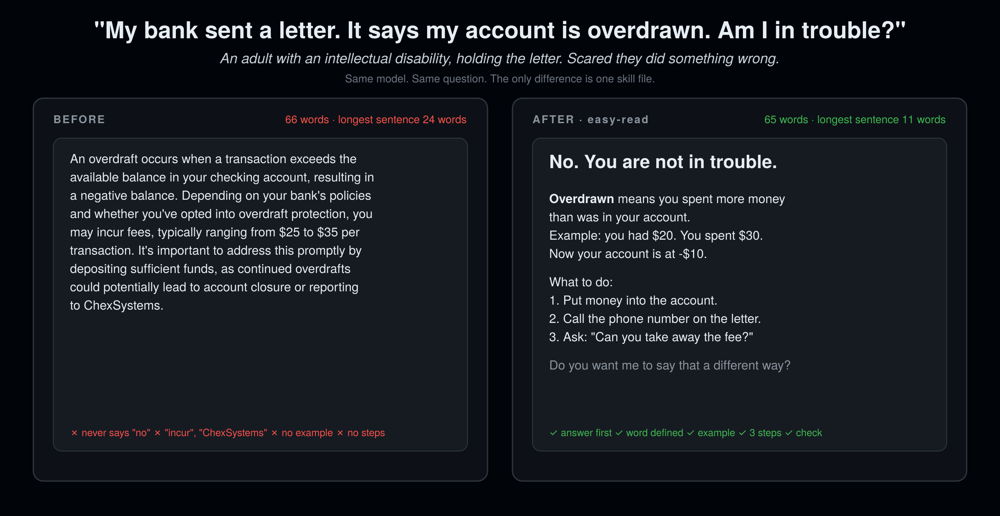

<div align="center">

# easy-read

### Your AI writes in Easy Read.

**Built for adults with intellectual and developmental disabilities. Better for everyone.**

12 rules. 0 code. Works in 16 agent hosts. Install in 10 seconds.

[](LICENSE)
[](SKILL.md)
[](#install)
[](CHANGELOG.md)
[](eval/)

**让你的 AI 用易读体写作。为智力和发展障碍成人设计，对所有人更好。**

[Install](#install) · [Before / After](#before--after) · [The 12 rules](#the-12-rules) · [Benchmark](#easyreadbench) · [Why not X](#why-not-no-subtext--eli5--readability-tools) · [FAQ](#faq)

```bash
npx skills add rosenhub/easy-read
```



Part of [AI Their Way](https://github.com/rosenhub/ai-their-way) — siblings: [no-subtext](https://github.com/rosenhub/no-subtext) · [what-did-they-mean](https://github.com/rosenhub/what-did-they-mean) · [never-say-remember](https://github.com/rosenhub/never-say-remember) · [presume-competence](https://github.com/rosenhub/presume-competence) · [low-demand](https://github.com/rosenhub/low-demand) · [is-this-a-scam](https://github.com/rosenhub/is-this-a-scam) · [one-thing](https://github.com/rosenhub/one-thing)

</div>

---

Adults with intellectual and developmental disabilities get the same chatbot everyone else gets. That chatbot writes like a lawyer:

- 30-word sentences with three ideas in them.
- "Utilize," "facilitate," "in order to," "prior to."
- A term like "durable power of attorney" used four times and defined never.
- Abstract ideas with no example of what they look like on a Tuesday.
- Steps buried in a paragraph instead of listed in order.
- Or, when you ask for simpler, a cartoon voice. "Think of it like a magic piggy bank!"

None of that is an IDD problem. It is a writing problem. People with IDD notice it first because they can't skim past it. Fix the writing and everyone gets an answer they can act on the first time. This is the curb-cut effect, applied to language models.

`easy-read` is one markdown file that tells any agent: one idea per sentence, everyday words, define every hard word, one example for every idea, adult tone.

Easy Read is an established standard. Self-advocacy organizations in the UK and EU have used it for decades for government forms, health leaflets and voting guides. This skill follows the writing part of that standard. It is not a certification and does not claim to be.

## Install

### One line (any host that reads `SKILL.md`)

```bash
npx skills add rosenhub/easy-read
```

### Or one line, no npm

```bash
curl -fsSL https://raw.githubusercontent.com/rosenhub/easy-read/main/install.sh | sh
```

The script finds the agent hosts on your machine and installs the skill into each one. It prints what it did. It does not touch anything else.

### Or by hand

Copy `SKILL.md` to the location for your host:

| Host | Where it goes | Scope |
|---|---|---|
| **Claude Code** | `~/.claude/skills/easy-read/SKILL.md` | all projects |
| **Claude Code** (one project) | `.claude/skills/easy-read/SKILL.md` | this repo |
| **Claude.ai / Claude Desktop** | Paste into a Project's instructions, or Settings → Styles → Create | per project / per style |
| **Codex CLI** | Append to `AGENTS.md` (repo) or `~/.codex/AGENTS.md` (global) | repo / global |
| **Cursor** | `.cursor/rules/easy-read.mdc` (set `alwaysApply: true`) | repo |
| **Windsurf** | `.windsurf/rules/easy-read.md` or `~/.codeium/windsurf/memories/global_rules.md` | repo / global |
| **Gemini CLI** | Append to `GEMINI.md` (repo) or `~/.gemini/GEMINI.md` (global) | repo / global |
| **OpenCode** | Append to `AGENTS.md` | repo |
| **Cline** | `.clinerules/easy-read.md` | repo |
| **Roo Code** | `.roo/rules/easy-read.md` | repo |
| **GitHub Copilot** | Append to `.github/copilot-instructions.md` | repo |
| **Aider** | Append to `CONVENTIONS.md`, add to `read:` in `.aider.conf.yml` | repo |
| **Amp** | Append to `AGENTS.md` | repo |
| **Kiro** | `.kiro/steering/easy-read.md` | repo |
| **OpenClaw** | `~/.openclaw/skills/easy-read/SKILL.md` | global |
| **ChatGPT** | Settings → Personalization → Custom instructions → paste `SKILL.md` body | account |

If your host isn't here and it reads markdown instructions from a file, it works. Open an issue with the path and I'll add the row.

## Before / After

Same model. Same prompt. The only change is the skill.

### "My bank sent a letter that says my account is overdrawn. Am I in trouble?"

*An adult with an intellectual disability, holding the letter. Scared they did something wrong.*

**Before**

> An overdraft occurs when a transaction exceeds the available balance in your checking account, resulting in a negative balance. Depending on your bank's policies and whether you've opted into overdraft protection, you may incur fees, typically ranging from $25 to $35 per transaction. It's important to address this promptly by depositing sufficient funds, as continued overdrafts could potentially lead to account closure or reporting to ChexSystems.

**After**

> No. You are not in trouble.
>
> **Overdrawn** means you spent more money than was in your account. Example: you had $20. You spent $30. Now your account is at -$10.
>
> What to do:
> 1. Put money into the account.
> 2. Call the phone number on the letter.
> 3. Ask: "Can you take away the fee?"
>
> Do you want me to say that a different way?

### "My landlord says I have to pay a late fee. Is that allowed?"

**Before**

> Whether a landlord can legally impose a late fee is governed by the terms of your lease agreement as well as applicable state and municipal regulations, which vary considerably across jurisdictions. Generally speaking, late fees are permissible provided they are explicitly stipulated in the lease, are reasonable in amount (many states cap them at a percentage of the monthly rent), and are assessed only after any grace period has elapsed. However, some jurisdictions impose additional constraints, so it would be prudent to review your lease carefully and, if necessary, consult a local tenants' rights organization in order to ascertain your specific obligations.

**After**

> **Usually yes**, but only if 3 things are true.
>
> 1. The late fee is **written in your lease**. Your lease is the paper you signed to rent your home.
> 2. The fee is **not too big**. In many states the limit is about 5% of your rent. For example, if your rent is $1,000, the fee can be about $50.
> 3. You paid **after the grace period**. A grace period is extra days to pay with no fee. Many leases give 5 days.
>
> If any of those 3 is false, you can say no to the fee.
>
> Tell me your state and I will check the limit there. Do you want me to say that a different way?

### "The pharmacy said my prescription needs prior authorization. What does that mean?"

**Before**

> Prior authorization (sometimes abbreviated PA) is a utilization management process employed by health insurers whereby certain medications, procedures, or services must be approved by the insurer before they will be covered. In practice, this means your prescribing physician must submit documentation demonstrating medical necessity, after which the insurer reviews the request and renders a determination, typically within several business days. If the request is denied, you may have the option to appeal, or your physician may prescribe an alternative that is on the plan's formulary. It's a frustrating process, but it's quite common, so don't worry too much!

**After**

> It means your **insurance** wants to check before it pays for this medicine.
>
> Your **doctor** has to ask the insurance company. You do not have to ask. For example, the doctor's office sends a form that says why you need this medicine.
>
> It usually takes **2 to 5 days** to get an answer.
>
> What to do now:
>
> 1. Call your doctor's office. Say "The pharmacy needs prior authorization for my medicine."
> 2. Ask them to send the form today.
> 3. Call the pharmacy in 3 days to see if it is ready.
>
> If the insurance says **no**, the doctor can try a different medicine.
>
> Do you want me to go through step 1 in more detail?

## The 12 rules

| # | Rule | Replaces |
|---|---|---|
| 1 | **One idea per sentence.** Split on "and," "which," "but," semicolons. | "A lease is a contract which sets out the rent and the rules, but..." |
| 2 | **Under 15 words per sentence.** Count. | 33-word sentences |
| 3 | **Everyday words.** "use," "buy," "before," "to." | "utilize," "purchase," "prior to," "in order to" |
| 4 | **Define every hard word where it appears.** "A notary is a person who checks it is really you." | using "notary" 4 times, defining it never |
| 5 | **One example for every idea.** "For example, if you are in the hospital..." | "manage your financial affairs" |
| 6 | **Digits, not words, for numbers.** "3 days," "$50." | "three days," "a couple of forms" |
| 7 | **Steps as a numbered list.** One action per number, in order. | steps buried in a paragraph |
| 8 | **The most important thing first.** "Yes" or "No" is word one. | background, then history, then the answer |
| 9 | **Bold the key word in each paragraph.** | a wall of same-weight text |
| 10 | **No idioms or metaphors.** "this is hard." | "an uphill battle," "get the ball rolling" |
| 11 | **Plain is not childish.** Adult voice, adult topics, no cheer. | "Think of it like a magic piggy bank!" |
| 12 | **End with one check question.** "Do you want me to say that a different way?" | ending on a 40-word disclaimer |

Rule 11 is the one that started all of this. A man in his 30s with Down syndrome asked a chatbot about a lease. The first answer was a legal memo he could not read. He asked for simpler. The second answer called the lease "a pinky promise with your landlord" and ended with a smiley face. He closed the app. Both answers failed, and the second one failed worse, because it told him what the model thought of him. Easy Read lowers the reading level and keeps the respect. That is the whole trick, and it is harder than it sounds.

Full text with examples and a pre-send self-check: [SKILL.md](SKILL.md).

What it is **not**: childish, short for its own sake, or a replacement for the person. An Easy Read answer can be long. It cannot be dense. If a sentence would sound wrong said to a 40-year-old at a bank, it is wrong.

## EasyReadBench

A benchmark for how readable an agent's output is. 48 prompts across 8 categories (money, health appointments, legal forms, housing, work, transport, technology, relationships). Each response is scored 0–6 on the six self-check questions by an LLM judge, plus a deterministic lint that needs no API key and counts sentence length and paragraph length on its own.

```bash
cd eval
pip install -r requirements.txt

# deterministic lint, no API key needed
python lint.py samples/before.md samples/after.md

# full run, with and without the skill
ANTHROPIC_API_KEY=... python run.py --model claude-sonnet-4-5
```

`run.py` prints a table and writes `results/<model>-<date>.md`. The rubric is in [eval/rubric.md](eval/rubric.md). Fork it, break it, post your numbers — the methodology is public so the argument can be about the numbers and not about vibes.

## Why not no-subtext / ELI5 / readability tools?

Use them too. They do different jobs.

| | **easy-read** | [no-subtext](https://github.com/rosenhub/no-subtext) | "Explain like I'm 5" prompts | Readability tools (Hemingway, Flesch) |
|---|---|---|---|---|
| Goal | reading level | remove implied meaning | simplify | measure |
| Sentence length cap | 15 words | none | none | reports it |
| Defines every hard word | yes | no | sometimes | no |
| Example for every idea | yes | no | sometimes | no |
| Adult tone guaranteed | yes | yes | no | n/a |
| Writes the answer | yes | yes | yes | no, scores it |
| Benchmark included | yes | yes | no | n/a |

`easy-read` is about **reading level**, not literalness. A no-subtext answer can still have 30-word sentences. An Easy Read answer cannot.

## Who made this

Josh Rosenfeld. I build AI for autistic adults and people with intellectual and developmental disabilities — [AlwaysHere](https://alwayshere.app), a voice companion; the tech behind [Find Love Safely](https://findlovesafely.com), [InControl](https://incontrolmn.com) and [CCHI](https://thecchi.org); and AI trainings for parents and professionals around the US. Before that, 30 years of UX, including the design system for ShowingTime (Zillow).

These 12 rules are the writing layer of [Guardian](https://guardian.alwayshere.app), the paid product, with everything else taken off. Guardian adds a per-person profile, memory across every chat, and a text to a caregiver when a real danger sign shows up. If you only need the agent to write plainly, this file is enough. If you're setting it up for someone else, that's Guardian.

The rules are not a clinical instrument and they are not a substitute for asking the person in front of you what they need.

## FAQ

<details>
<summary><b>Isn't this just ELI5?</b></summary>

No. "Explain like I'm 5" is childish. It gives you cartoons, piggy banks and exclamation marks. Easy Read is adult. It was built by self-advocates to put real information about rent, medicine and the law in front of adults who read at a lower level. The reading level drops. The respect does not. Rule 11 exists to keep it that way.
</details>

<details>
<summary><b>I don't have IDD. Should I use it?</b></summary>

Yes. Every rule in the file is a rule a good editor would give you. Short sentences, defined terms, one example per idea. The IDD framing is about who noticed first, not who it's for. People who read in a second language and people reading on a phone at 11pm report the same relief.
</details>

<details>
<summary><b>Does it make answers shorter or longer?</b></summary>

Usually a little longer. Defining terms and adding examples adds words. Cutting formal phrasing removes some. EasyReadBench reports word counts and longest-sentence length so you can check.
</details>

<details>
<summary><b>Can I change the rules?</b></summary>

Yes. It's a markdown file. Delete the ones you don't want. If you think a rule is wrong for people with IDD specifically, open an issue — that's the kind of feedback I want most.
</details>

<details>
<summary><b>Will it fight with my other skills?</b></summary>

It overrides writing style only. It does not tell the agent what to do, what to build, or what to know. Stack it with anything. It pairs well with [one-thing](https://github.com/rosenhub/one-thing) for tasks and [is-this-a-scam](https://github.com/rosenhub/is-this-a-scam) for suspicious messages.
</details>

<details>
<summary><b>Is this certified Easy Read?</b></summary>

No. Real Easy Read documents are checked by people with learning disabilities before they go out, and they use pictures next to the text. This skill follows the writing rules only. It makes the agent's text plainer. It does not make it certified, and it does not replace a human reviewer.
</details>

## Contributing

Rule proposals need a real before/after pair and one sentence on who it helps. Contributors with IDD, and the people who support them: your experience is the evidence. See [CONTRIBUTING.md](CONTRIBUTING.md).

## Star history

<a href="https://star-history.com/#rosenhub/easy-read&Date">
  
</a>

## License

MIT. Copy it, fork it, ship it inside your product. Attribution is appreciated and not required.
